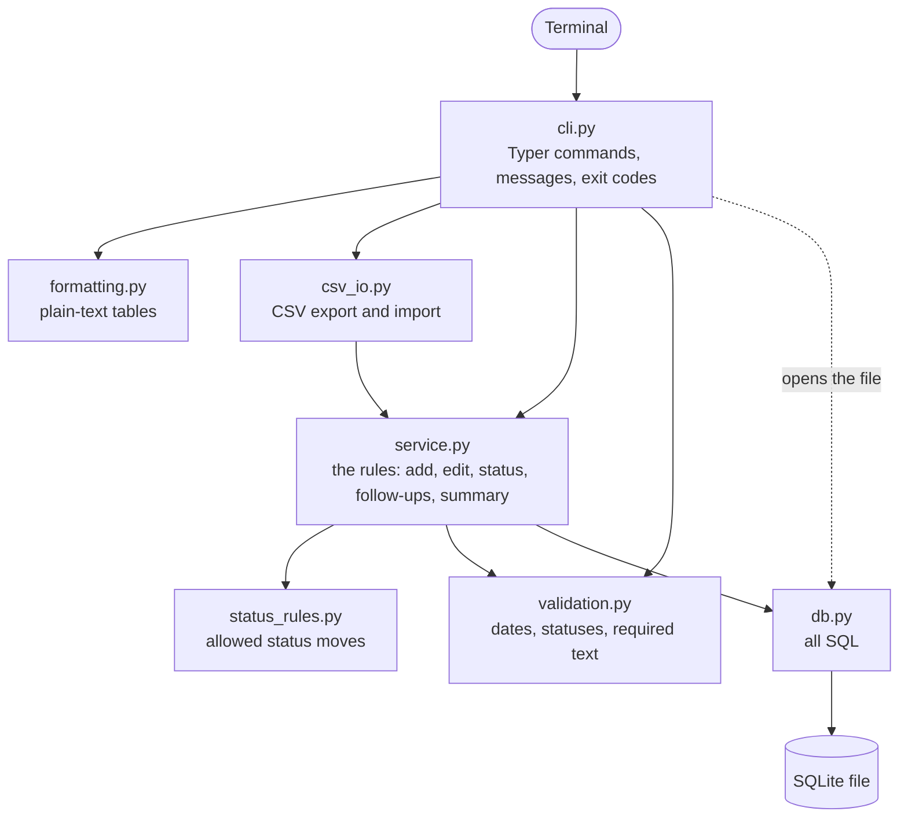

# job-tracker-cli

[](https://github.com/Omkar210404/Job-Tracker-CLI/actions/workflows/tests.yml)

A command-line tool to track job applications. Everything is stored in one SQLite file on your own computer.

```console
$ jobtrack due
Follow-ups as of 2026-03-20:

ID  Company                  Role                        Status     Follow-up   Due
--  -----------------------  --------------------------  ---------  ----------  ------------------
 4  Harbor Placeholder Tech  Backend Developer (Python)  applied    2026-03-06  overdue by 14 days
 3  Cedar Demo Analytics     Data Analyst                screening  2026-03-18  overdue by 2 days
 5  Lumen Fictional Labs     AI Engineer (Fresher)       interview  2026-03-20  due today

2 overdue, 1 due today
```

All output in this README is real: it is copied from [examples/demo_output.txt](examples/demo_output.txt), which `python scripts/demo.py` produces by running the actual program on **synthetic sample data**. Every company, role and link shown is invented.

## The problem

A job search means many applications at different stages, and a spreadsheet does not answer the questions that matter day to day: who have I not heard from, who should I follow up with today, how long do replies usually take. This tool keeps each application with its status history and follow-up date, and answers those questions from the terminal.

## What it does

- Add an application: company, role, link, location, date applied, source, notes.
- Move it through a pipeline: `saved`, `applied`, `screening`, `interview`, `offer`, `rejected`, `withdrawn`. Every change is kept in a history.
- Set a follow-up date and list what is due or overdue.
- List and filter by status, company, applied date range and text search.
- Summarise: counts per status, response rate, average days from applied to first response. Computed only from your own rows.
- Export to CSV and import from CSV.
- Edit and delete, with a confirmation before deleting.

## Install

Needs Python 3.11 or newer.

```bash
git clone https://github.com/Omkar210404/Job-Tracker-CLI.git
cd Job-Tracker-CLI
python -m venv .venv
```

Activate the environment:

```powershell
.venv\Scripts\Activate.ps1      # Windows PowerShell
```

```bash
source .venv/bin/activate       # macOS / Linux
```

Then install:

```bash
pip install -r requirements.txt
pip install -e .
jobtrack --help
```

`pip install -e .` adds the `jobtrack` command. Without it, run `python -m jobtracker` from the repository folder instead; the two are the same program.

To see it working before entering anything of your own:

```bash
python scripts/demo.py
```

The demo uses a temporary database and never opens yours.

## Usage

The examples follow the demo, where "today" is fixed at 2026-03-20.

### Add

```console
$ jobtrack add --company "Northwind Example Ltd" --role "Junior Python Developer" --location Pune --source "job board" --link https://example.com/jobs/1 --notes "synthetic sample" --date-applied 2026-02-10
Added application 1: Junior Python Developer at Northwind Example Ltd (applied on 2026-02-10).
```

Only `--company` and `--role` are required. The applied date defaults to today. A job you have not applied to yet goes in with `--status saved`:

```console
$ jobtrack add --company "Granite Fictional Systems" --role "Data Engineer Trainee" --location Pune --source "job board" --link https://example.com/jobs/11 --notes "synthetic sample" --status saved
Added application 11: Data Engineer Trainee at Granite Fictional Systems (saved, not applied yet).
```

### Update the status

```console
$ jobtrack status 1 screening --date 2026-02-17 --note "phone screen booked"
Application 1: applied -> screening on 2026-02-17.
First response recorded, 7 days after applying.

$ jobtrack status 1 interview --date 2026-02-26
Application 1: screening -> interview on 2026-02-26.
```

`--date` defaults to today. Stages can be skipped:

```console
$ jobtrack status 5 interview --date 2026-03-09 --note "skipped the phone screen"
Application 5: applied -> interview on 2026-03-09.
First response recorded, 12 days after applying.
```

### Follow-ups

Dates are `YYYY-MM-DD` or `today`. A follow-up date can also be `+4d`, meaning four days from today.

```console
$ jobtrack followup 5 today
Application 5: follow-up set for 2026-03-20.

$ jobtrack followup 7 +4d
Application 7: follow-up set for 2026-03-24.
```

`jobtrack followup 7 --clear` removes the date. `due` shows what needs attention, most overdue first, and `--within` looks ahead:

```console
$ jobtrack due --within 7
Follow-ups as of 2026-03-20:

ID  Company                  Role                        Status     Follow-up   Due
--  -----------------------  --------------------------  ---------  ----------  ------------------
 4  Harbor Placeholder Tech  Backend Developer (Python)  applied    2026-03-06  overdue by 14 days
 3  Cedar Demo Analytics     Data Analyst                screening  2026-03-18  overdue by 2 days
 5  Lumen Fictional Labs     AI Engineer (Fresher)       interview  2026-03-20  due today
 7  Pinecrest Sample Data    Junior Data Scientist       screening  2026-03-24  in 4 days
 9  Tidewater Demo Co        Software Engineer Trainee   applied    2026-03-26  in 6 days

2 overdue, 1 due today, 2 upcoming
```

Rejected and withdrawn applications are left out of `due`.

### List and filter

```console
$ jobtrack list
ID  Company                    Role                        Status     Applied     Follow-up   Location
--  -------------------------  --------------------------  ---------  ----------  ----------  ---------
 1  Northwind Example Ltd      Junior Python Developer     offer      2026-02-10  -           Pune
 2  Bluefield Sample Systems   ML Engineer Intern          rejected   2026-02-12  -           Remote
 3  Cedar Demo Analytics       Data Analyst                screening  2026-02-18  2026-03-18  Mumbai
 4  Harbor Placeholder Tech    Backend Developer (Python)  applied    2026-02-20  2026-03-06  Bengaluru
 5  Lumen Fictional Labs       AI Engineer (Fresher)       interview  2026-02-25  2026-03-20  Hyderabad
 6  Quartz Mock Software       Python Developer            withdrawn  2026-03-02  -           Remote
 7  Pinecrest Sample Data      Junior Data Scientist       screening  2026-03-05  2026-03-24  Pune
 8  Orchid Example Works       NLP Engineer Intern         rejected   2026-03-09  -           Mumbai
 9  Tidewater Demo Co          Software Engineer Trainee   applied    2026-03-12  2026-03-26  Chennai
10  Maple Placeholder AI       ML Engineer (Entry Level)   applied    2026-03-16  -           Remote
11  Granite Fictional Systems  Data Engineer Trainee       saved      -           -           Pune
12  Willow Mock Robotics       Computer Vision Intern      saved      -           -           Bengaluru

12 applications
```

Filters combine, so every one given must match:

```console
$ jobtrack list --status applied,screening
ID  Company                  Role                        Status     Applied     Follow-up   Location
--  -----------------------  --------------------------  ---------  ----------  ----------  ---------
 3  Cedar Demo Analytics     Data Analyst                screening  2026-02-18  2026-03-18  Mumbai
 4  Harbor Placeholder Tech  Backend Developer (Python)  applied    2026-02-20  2026-03-06  Bengaluru
 7  Pinecrest Sample Data    Junior Data Scientist       screening  2026-03-05  2026-03-24  Pune
 9  Tidewater Demo Co        Software Engineer Trainee   applied    2026-03-12  2026-03-26  Chennai
10  Maple Placeholder AI     ML Engineer (Entry Level)   applied    2026-03-16  -           Remote

5 applications

$ jobtrack list --search remote --from 2026-03-01
ID  Company               Role                       Status     Applied     Follow-up  Location
--  --------------------  -------------------------  ---------  ----------  ---------  --------
 6  Quartz Mock Software  Python Developer           withdrawn  2026-03-02  -          Remote
10  Maple Placeholder AI  ML Engineer (Entry Level)  applied    2026-03-16  -          Remote

2 applications
```

`--search` looks in company, role, location, source and notes. Other options: `--company`, `--to`, `--sort id|company|applied|followup|status`, `--desc`, `--limit`.

`show` prints every field and the status history:

```console
$ jobtrack show 1
Application 1
  Company:         Northwind Example Ltd
  Role:            Junior Python Developer
  Status:          offer
  Applied:         2026-02-10
  First response:  2026-02-17
  Follow-up:       -
  Location:        Pune
  Source:          job board
  Link:            https://example.com/jobs/1
  Notes:           synthetic sample

History
  2026-02-10  added as applied
  2026-02-17  applied -> screening  (phone screen booked)
  2026-02-26  screening -> interview
  2026-03-12  interview -> offer
```

### Summary

```console
$ jobtrack summary
Applications: 12

Status     Count
---------  -----
saved          2
applied        3
screening      2
interview      1
offer          1
rejected       2
withdrawn      1

Response rate: 60.0% (6 of 10 applied got a response)
Average days from applied to first response: 10.8 (based on 6 applications)
```

`--from` and `--to` limit it to applications applied in a date range. The definitions are in [How the summary is calculated](#how-the-summary-is-calculated).

### Edit and delete

```console
$ jobtrack edit 9 --location "Chennai (hybrid)" --source ""
Updated application 9: location, source.

Application 9
  Company:         Tidewater Demo Co
  Role:            Software Engineer Trainee
  Status:          applied
  Applied:         2026-03-12
  First response:  -
  Follow-up:       2026-03-26
  Location:        Chennai (hybrid)
  Source:          -
  Link:            https://example.com/jobs/9
  Notes:           synthetic sample
```

Only the options given are changed, and an empty value clears an optional field.

`delete` shows the application and asks first. Here `n` is piped in as the answer, so it is not echoed after the prompt:

```console
$ echo n | jobtrack delete 12
Application 12
  Company:         Willow Mock Robotics
  Role:            Computer Vision Intern
  Status:          saved
  Applied:         -
  First response:  -
  Follow-up:       -
  Location:        Bengaluru
  Source:          referral
  Link:            https://example.com/jobs/12
  Notes:           synthetic sample

Delete this application? This cannot be undone. [y/N]: Nothing deleted.

$ jobtrack delete 12 --yes
Deleted application 12: Computer Vision Intern at Willow Mock Robotics.
```

### Export and import

```console
$ jobtrack export applications.csv
Exported 12 applications to applications.csv.

# first 4 lines of applications.csv
id,company,role,link,location,source,status,date_applied,follow_up_date,first_response_date,notes
1,Northwind Example Ltd,Junior Python Developer,https://example.com/jobs/1,Pune,job board,offer,2026-02-10,,2026-02-17,synthetic sample
2,Bluefield Sample Systems,ML Engineer Intern,https://example.com/jobs/2,Remote,referral,interview,2026-02-12,,2026-02-24,synthetic sample
3,Cedar Demo Analytics,Data Analyst,https://example.com/jobs/3,Mumbai,company site,screening,2026-02-18,2026-03-18,2026-03-03,synthetic sample
```

Importing that file into a second, empty database:

```console
$ jobtrack --db second.db import applications.csv --dry-run
Dry run: 12 applications would be imported, 0 duplicates skipped. Nothing was stored.

$ jobtrack --db second.db import applications.csv
Imported 12 applications from applications.csv, skipped 0 duplicates.

$ jobtrack --db second.db import applications.csv
Imported 0 applications from applications.csv, skipped 12 duplicates.
```

Import rules:

- The file needs the columns `company` and `role`. Optional: `link`, `location`, `source`, `status`, `date_applied`, `follow_up_date`, `first_response_date`, `notes`. An `id` column is ignored and new ids are assigned.
- Every row is checked first. If any row is invalid, each problem is listed with its line number and nothing is imported.
- A row that matches a stored application on company, role and applied date is skipped, so importing the same file twice does not double the data.
- `--dry-run` reports what would happen and stores nothing.

### When something is wrong

Invalid input gives a one-line message and exit code 1, not a stack trace:

```console
$ jobtrack add --company "Typo Example Co" --role Developer --date-applied 12/03/2026
Error: Invalid applied date '12/03/2026'. Use YYYY-MM-DD (for example 2026-03-20) or 'today'.
(exit code 1)

$ jobtrack status 4 intervew
Error: Unknown status 'intervew'. Did you mean 'interview'? Valid statuses: saved, applied, screening, interview, offer, rejected, withdrawn.
(exit code 1)

$ jobtrack status 1 applied
Error: Cannot move from 'offer' to 'applied': from 'offer' the next status can be: rejected, withdrawn. Use --force if you are correcting a mistake.
(exit code 1)

$ jobtrack status 2 interview
Error: Cannot move from 'rejected' to 'interview': 'rejected' is a closed status, so it normally does not change. Use --force if you are correcting a mistake.
(exit code 1)
```

A wrong entry can be corrected with `--force`, and the correction stays visible in the history:

```console
$ jobtrack status 2 interview --force --note "rejection was entered by mistake"
Application 2: rejected -> interview on 2026-03-20.
```

Every command has `--help`.

## Status rules

Pipeline: `saved` → `applied` → `screening` → `interview` → `offer`. Closed: `rejected`, `withdrawn`.

| From | Allowed next |
|------|--------------|
| `saved` | `applied`, `withdrawn` |
| `applied` | `screening`, `interview`, `offer`, `rejected`, `withdrawn` |
| `screening` | `interview`, `offer`, `rejected`, `withdrawn` |
| `interview` | `offer`, `rejected`, `withdrawn` |
| `offer` | `rejected`, `withdrawn` |
| `rejected`, `withdrawn` | nothing |

- Any other move, such as going back a stage or reopening a closed application, needs `--force`.
- Moving from `saved` to `applied` sets the applied date.
- A status change cannot be dated in the future or before the applied date.

## How the summary is calculated

Every number comes from the applications you entered. The tool contains no benchmarks or "typical" figures.

- **Response**: reaching `screening`, `interview`, `offer` or `rejected`. Withdrawing is your own action, so it does not count.
- **First response date**: the date of the first status change into one of those four. Later changes do not move it. It is cleared only if you force the application back to `saved` or `applied`.
- **Applied**: applications that have an applied date. `saved` ones are not counted.
- **Response rate**: responded ÷ applied. Both counts are printed next to the percentage. With nothing applied it prints `n/a`.
- **Average days from applied to first response**: the mean of first response date minus applied date, over responded applications that have both dates. The number of applications it is based on is printed next to it.

In the demo above: 12 applications, 2 of them only saved, so 10 applied. Six got a response, after 7, 12, 13, 12, 11 and 10 days, which gives 60.0% and an average of 10.8 days.

## Where your data lives

- Default: `.jobtrack/jobtrack.db` in your home folder (on Windows, `C:\Users\<you>\.jobtrack\jobtrack.db`). It is created on first use.
- Another file for one command: `jobtrack --db path/to/file.db list`.
- Another file for the session: set the environment variable `JOBTRACK_DB`.

The repository's `.gitignore` excludes `*.db` and `*.csv`, so a database or export kept inside the project folder is not committed by accident.

## Project structure

Three layers: CLI, service, database. The CLI opens the database file and hands the connection to the service; after that the service is the only caller of the SQL functions. The rules can therefore be tested without the CLI, and the SQL without the rules.



```
job-tracker-cli/
├── jobtracker/
│   ├── cli.py            # CLI layer: parses arguments, prints, sets exit codes
│   ├── formatting.py     # text tables and summary text
│   ├── csv_io.py         # CSV export and import
│   ├── service.py        # service layer: all the rules, never prints
│   ├── status_rules.py   # which status moves are allowed
│   ├── validation.py     # parsing of dates, statuses and required text
│   ├── db.py             # database layer: schema and every SQL statement
│   ├── models.py         # Status enum and dataclasses
│   ├── errors.py         # errors that become messages
│   └── __main__.py       # python -m jobtracker
├── scripts/demo.py       # runs the real CLI on synthetic data
├── examples/demo_output.txt
├── tests/
├── .github/workflows/tests.yml
├── PLAN.md               # the plan this was built from
├── pyproject.toml
└── requirements.txt
```

The database has two tables: `applications` (one row each) and `status_history` (one row per status change, deleted together with its application). "Today" is passed into the service layer as an argument instead of being read from the clock there, which is why the follow-up and summary tests give the same result on any day.

## Tests

```bash
python -m pytest
```

Last local run, on 2026-10-10 with Windows 11 and Python 3.11.9: **394 passed**.

| File | What it covers |
|------|----------------|
| `test_db.py` | schema creation, insert / get / update / delete, constraints, cascade delete, filter and sort queries |
| `test_validation.py` | date formats, impossible dates, `today`, `+7d`, status names |
| `test_status_rules.py` | every one of the 49 status pairs against a hand-written table |
| `test_status_changes.py` | status changes on stored applications: dates that move with them, `--force`, history |
| `test_service.py` | add, edit, delete, filters |
| `test_followup.py` | setting and clearing, due / overdue boundaries, closed applications left out |
| `test_summary.py` | counts, response rate and average days against values worked out by hand |
| `test_csv.py` | export, import, round trip, invalid rows, duplicates, dry run |
| `test_cli.py` | every command through Typer's test runner: output, error messages, exit codes, delete confirmation |
| `test_demo.py` | runs the demo and fails if `examples/demo_output.txt` or a README example no longer matches |

Every test uses its own temporary database. The GitHub Actions workflow runs the suite on every push, on Ubuntu and Windows with Python 3.11 and 3.13; the badge at the top shows the result of the latest run.

## Limitations

- **Local and single user.** One SQLite file on one machine. No accounts, no sync between devices, no shared use, and no automatic backup. `jobtrack export` is the backup.
- **No reminders.** Nothing notifies you. `jobtrack due` only answers when you run it.
- **The numbers are only as good as the entries.** A response is a status change you recorded, on the date you gave. With a handful of applications the response rate and the average are small-sample figures and say little.
- **CSV does not carry the status history.** An imported application starts with a single history entry. If an imported row has a response status but no `first_response_date`, it counts in the response rate and is left out of the average.
- **Dates in the history are not checked against each other**, only against the applied date and today.
- **Duplicates are detected on import only**, by exact company, role and applied date. `add` does not warn about a second entry for the same job.
- **Search is plain substring matching**, case-insensitive for the letters A to Z only.
- **Import accepts `YYYY-MM-DD` dates only.** A spreadsheet program that re-saves the file with another date format will make the import fail, with the line numbers listed. Cells starting with `=` in an exported file may be read as formulas by spreadsheet programs.
- **Table layout assumes a fixed-width font and Latin text.** Wide characters misalign the columns, and characters the console cannot encode are shown as `?`. The stored text is not affected.
- **Dates only**, no times or time zones.
- **No schema migrations.** The schema version is stored, but nothing upgrades an old database yet.
- **Not load tested.** It was run with the 12-row demo and the test data; no claim is made about very large numbers of applications.
- **Platforms.** Built and run on Windows 11 with Python 3.11.9. Other platforms are covered only by the CI runs.

## Future ideas

- Contacts and interview rounds per application.
- Tags, and summary breakdowns by source or by month.
- Export and import of the status history (JSON), so a backup is complete.
- Schema migrations.
- A warning in `add` when a similar application already exists.
- Optional desktop or email reminders for due follow-ups.

## License

[MIT](LICENSE)
